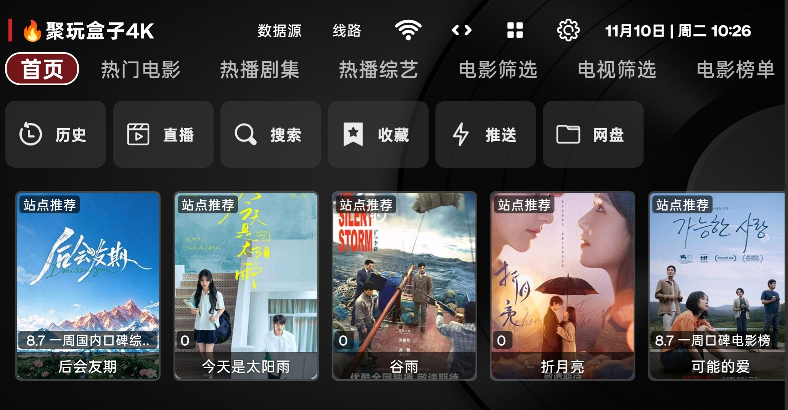
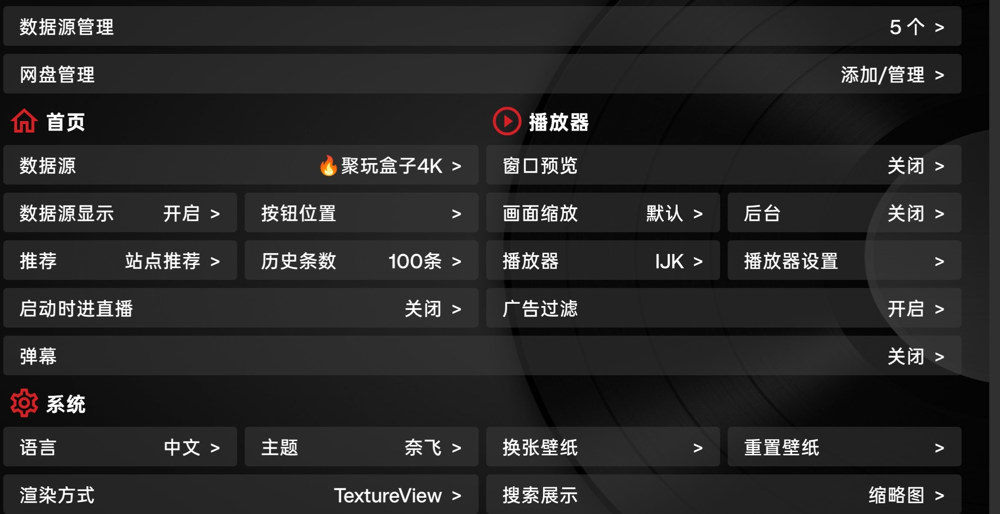
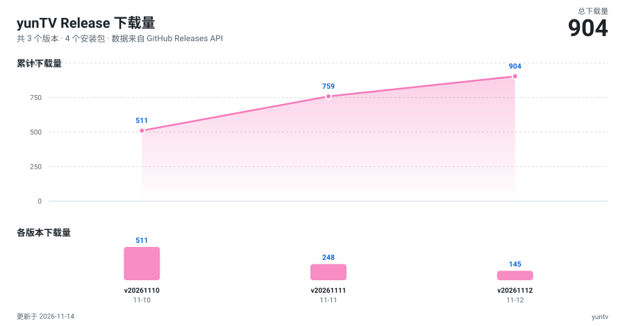

# 云TV (yunTV)

基于 TVBox 的开源影视盒子，适配电视盒子与手机横屏。

## ✨ 核心特性

### 🔍 自动搜索数据源
内置数据源自动发现：种子页抽取候选配置地址，自动校验结构（点播 `sites` / 直播 `#EXTM3U`），搜索结果带复选框、勾选后一键批量添加，不用再到处找配置地址。结果随机化，每次搜索发现新源。

### ✅ 一键验证源
批量测试数据源连通性：逐条显示 HTTP 状态、耗时、站点数/频道数，坏源一目了然。

### ✅ 支持从影视仓的本地备份导入观看记录
影视仓做了本地备份后,从yunTV里可以直接导入该备份,而且可以一键修复观看记录对应的源,无缝过度

### 其他
- 数据源管理：添加 / 扫码添加 / 编辑 
- 直播源 + EPG 支持
- WebDAV 备份同步
- 配置信息本地备份

## 📦 下载

| 文件 | 适用 |
|------|------|
| `yunTV-release-<日期>.apk` | arm64-v8a（主流手机/盒子） |
| `yunTV-release-<日期>-armeabi.apk` | armeabi-v7a（老盒子） |

### 📈 下载趋势

*数据来源：GitHub Releases API，由 GitHub Actions 每日自动更新。*

本项目不提供任何影视内容，所有内容均来自用户自行配置的第三方数据源。请遵守当地法律法规，仅用于技术学习交流。
